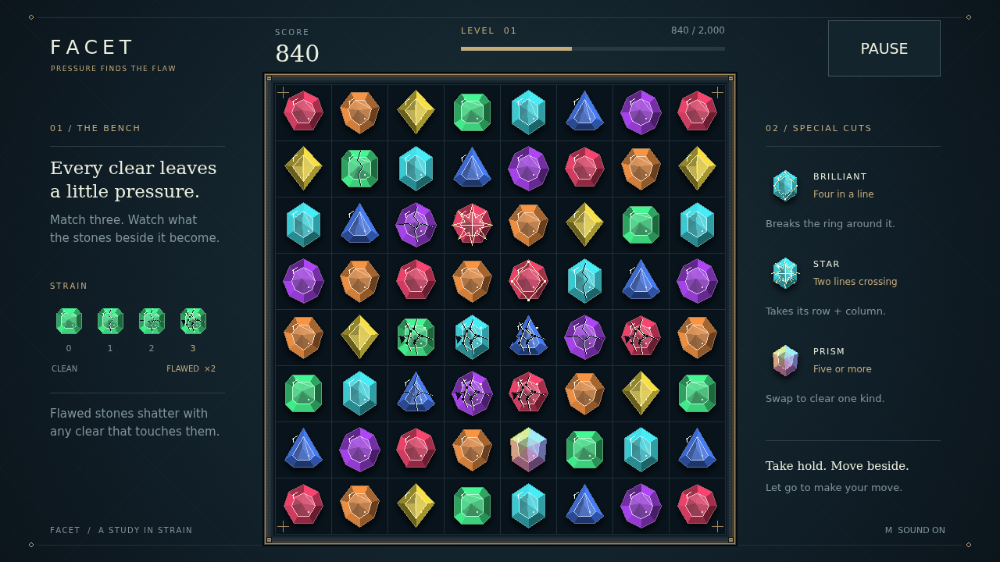

# Facet

A quiet bench. Sixty-four cut stones. One beautiful chain reaction. Take hold of a gem, carry it onto its neighbor, and let go to make a line of three or more shatter. Fresh stones tumble into the gaps—and sometimes the next match is already waiting.

Every clear leaves pressure behind. The stones beside it grow cracked, then fractured, then flawed. A flawed stone is worth double and breaks with any clear that touches it. Read the damage, build a fault line, and spend a whole corner’s worth of strain in one move.

Longer lines earn finer cuts. A brilliant breaks its surrounding ring; a star cuts through its entire row and column. A prism belongs to no kind at all: swap it with a stone to take that kind off the whole board. Together, they turn a small opening into a glittering cascade.

Each chain climbs in value. Reach the level’s target, admire your longest chain and best move, and return to a freshly dealt bench with your score intact. Keep finding the flaw until there is no move left.

